

  
   
  

# 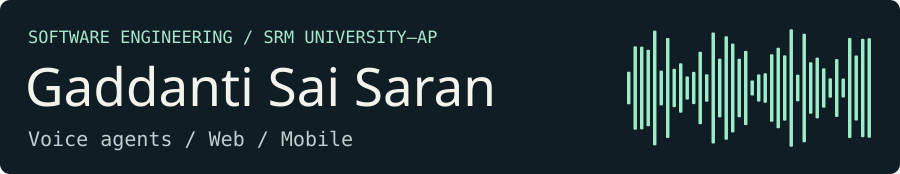

[Explore the projects](#projects) · [Open the icon rack](#stack) · [Connect with me](#connect)

I study Computer Science and Engineering at SRM University–AP (B.Tech, 2024–2028). I like working on the moment where software has to answer someone back, whether that’s a voice assistant hearing a command or a campus app explaining why a form failed.

## 

**SDE Intern · Full-stack and mobile development**

What I work on

I build responsive web and mobile interfaces, connect them to backend APIs, and debug features across the client and server. I also contribute to open source through GirlScript Summer of Code and am an associate at Next Tech Lab, SRM University–AP.

## 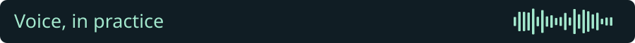

| Build | What happens when you speak |
| --- | --- |
| **Hey Baby** | Say “Hey Baby, open calculator” and the desktop assistant launches it. After setup, the wake phrase, spoken replies, and built-in actions work offline. [Try the desktop assistant](https://github.com/saisaran2116/heysaran) |
| **Sanjeevan** | A patient can talk to an assistant, review vitals, and read a plain-language summary of a report. Anurag Tummapudi and I built the prototype in 24 hours. I worked on the responsive interface and its backend integrations. [Open Sanjeevan](https://sanjeevan-omega.vercel.app/) · [Team repository](https://github.com/AnuragTummapudi/Sanjeevani) |

## 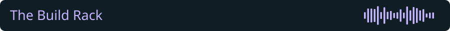

Select an icon to open its documentation.

**Languages**

  <a href="https://docs.python.org/3/" title="Python">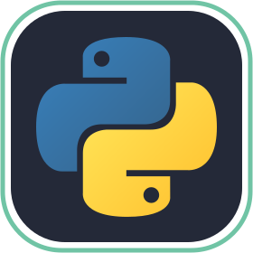</a>  <a href="https://www.postgresql.org/docs/current/tutorial-sql.html" title="SQL">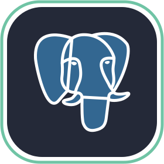</a>

**Web and mobile**

   <a href="https://vite.dev/guide/" title="Vite">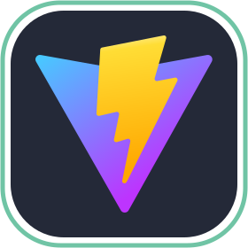</a> 

**Backend and storage**

  <a href="https://developer.mozilla.org/en-US/docs/Web/HTTP" title="REST APIs">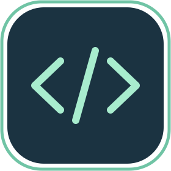</a>   <a href="https://www.mongodb.com/docs/" title="MongoDB">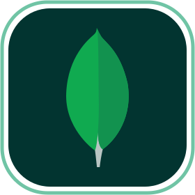</a>   

**Voice and AI**

  

**Tools and hosting**

<a href="https://git-scm.com/doc" title="Git">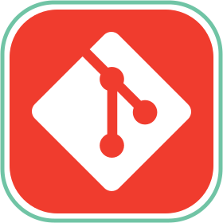</a> <a href="https://docs.github.com/" title="GitHub">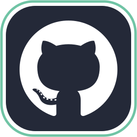</a>     <a href="https://render.com/docs" title="Render">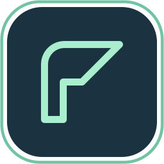</a>

## 

**Campus Hub**

Organizers turn a poster into an event listing, staff check the extracted details, and students save approved events. The scheduling logic handles bookings that run past midnight. [Live calendar](https://campus-hub-gamma-eight.vercel.app/) · [Source](https://github.com/saisaran2116/Campus-hub) · [Design notes](https://github.com/saisaran2116/Campus-hub/blob/main/LLD.md)

**KalCG**

A CGPA tracker used by 300+ members of the Kalvium community. When the query form started returning HTTP 504s, I changed the request path, added a ten-second timeout, and tested failure cases in Postman. [Visit KalCG](https://kalcg.netlify.app/)

## 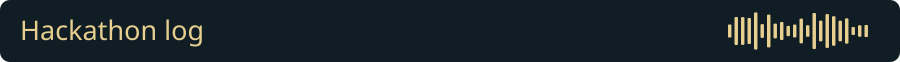

**Two runner-up finishes** · Omnitrix and CodeFusion at RD Conclave 2026

View the hackathon results

| Event | Our build | Result |
| --- | --- | --- |
| Omnitrix | Sanjeevan, a voice-enabled healthcare prototype | Runner-up |
| CodeFusion · RD Conclave 2026 | Real-time patient care | Runner-up |
| Web3SSH | Rescu3, an Ethereum hardware wallet recovery project | Top 10 teams |
| ETHGlobal Mumbai | An Ethereum-based project | Participant |

## 

Working on a voice interface or a tool for students? I’d love to compare notes.

Email me about a specific topic

[Discuss a voice agent](mailto:gaddantisaisaran@gmail.com?subject=Voice%20agent%20collaboration) · [Talk about a campus project](mailto:gaddantisaisaran@gmail.com?subject=Campus%20project)

