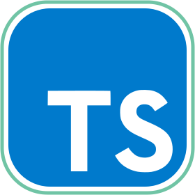
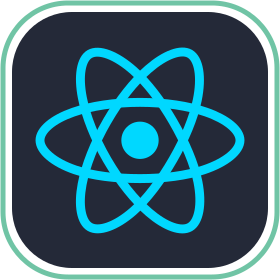

# 

<samp><strong>SDE Intern</strong> · Web & mobile · B.Tech CSE, SRM University–AP (2024–2028)</samp>

<samp>Two things I’ve built for fellow students are a campus event calendar and a CGPA tracker. I also work on voice interfaces. At Omnitrix, my teammate and I built a prototype that lets someone upload a medical report, read a summary, and ask a follow-up question out loud.</samp>

<samp><a href="#projects">Built Between Classes</a> · <a href="#experience">My Intern Notebook</a> · <a href="#tech-stack">Inside My Dev Kit</a> · <a href="#hackathons">Before the Buzzer</a> · <a href="#connect">My Inbox Is Open</a></samp>

## 

| <samp>Build</samp> | <samp>What it does</samp> | <samp>Links</samp> |
| --- | --- | --- |
| <samp><strong>Campus Hub</strong></samp> | <samp>Organizers upload an event poster and review the extracted details. Once staff approve the listing, students can find it on the calendar and save it.</samp> | <samp><a href="https://campus-hub-gamma-eight.vercel.app/">Calendar</a> · <a href="https://github.com/saisaran2116/Campus-hub">Code</a></samp> |
| <samp><strong>Sanjeevan</strong></samp> | <samp>A healthcare prototype that brings report summaries, vitals, and a voice assistant into one dashboard. I built the responsive interface and connected it to the backend.</samp> | <samp><a href="https://sanjeevan-omega.vercel.app/">Demo</a> · <a href="https://github.com/AnuragTummapudi/Sanjeevani">Code</a></samp> |
| <samp><strong>KalCG</strong></samp> | <samp>A grade calculator for the Kalvium community. More than 300 members have used it to track their academic performance.</samp> | <samp><a href="https://kalcg.netlify.app/">Tracker</a></samp> |

<samp>Build notes</samp>

- <samp><strong>Campus Hub</strong> checks for scheduling conflicts even when an event runs past midnight. <a href="https://github.com/saisaran2116/Campus-hub/blob/main/LLD.md">Read the scheduling design</a></samp>
- <samp><strong>Sanjeevan</strong> was a 24-hour build with Anurag Tummapudi. I built responsive components and connected them to the health-analysis backend.</samp>
- <samp><strong>KalCG</strong> had a query form that returned HTTP 504s. I routed submissions directly to the Express API, added a ten-second timeout, and tested failure cases in Postman.</samp>

## 

<samp>As an <strong>SDE Intern</strong>, I build web and mobile features from the screen through to the API. One part of that work I enjoy is tracing a failed request. On KalCG, a form submission could time out without telling the student what happened. I changed how the form reached the server and added an error message so the student knew when to try again.</samp>

<samp>Community roles</samp>

<samp>I contribute to open source through GirlScript Summer of Code and am an associate at Next Tech Lab at SRM University–AP.</samp>

## 

<samp>I use React for web interfaces, React Native for mobile apps, and Node.js and Express for APIs. For voice features, I’ve worked with LiveKit and Gemini. Each icon below opens the corresponding documentation.</samp>

<table>
<tr>
<td width="50%" valign="top"><strong><samp>Languages</samp></strong> 
    
</td>
<td width="50%" valign="top"><strong><samp>Web and mobile</samp></strong> 
    
</td>
</tr>
<tr>
<td width="50%" valign="top"><strong><samp>Backend APIs</samp></strong> 
   
</td>
<td width="50%" valign="top"><strong><samp>Databases</samp></strong> 
    
</td>
</tr>
<tr>
<td width="50%" valign="top"><strong><samp>AI and speech</samp></strong> 
  
</td>
<td width="50%" valign="top"><strong><samp>Tools and hosting</samp></strong> 
      
</td>
</tr>
</table>

## 

<samp>I’ve taken part in <strong>10+ hackathons</strong> and reached <strong>six finals</strong>. Our teams earned runner-up at Omnitrix and CodeFusion. At Web3SSH, we finished in the top 10 with Rescu3, an Ethereum hardware wallet recovery project.</samp>

<samp>Event results</samp>

| <samp>Event</samp> | <samp>Our build</samp> | <samp>Result</samp> |
| --- | --- | --- |
| <samp>Omnitrix</samp> | <samp>Sanjeevan, a voice-enabled healthcare prototype</samp> | <samp>Runner-up</samp> |
| <samp>CodeFusion · RD Conclave 2026</samp> | <samp>Real-time patient care</samp> | <samp>Runner-up</samp> |
| <samp>Web3SSH</samp> | <samp>Rescu3, an Ethereum hardware wallet recovery project</samp> | <samp>Top 10 teams</samp> |
| <samp>ETHGlobal Mumbai</samp> | <samp>An Ethereum-based project</samp> | <samp>Participant</samp> |

## 

<samp>I’d love to hear from people building student tools or experimenting with voice interfaces. If you’ve tried one of my projects, tell me what you used it for and what could work better.</samp>

<samp>Start an email about a project or opportunity</samp>

<samp><a href="mailto:gaddantisaisaran@gmail.com?subject=Project%20collaboration">Discuss a project</a> · <a href="mailto:gaddantisaisaran@gmail.com?subject=Internship%20opportunity">Discuss an internship</a></samp>

