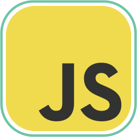
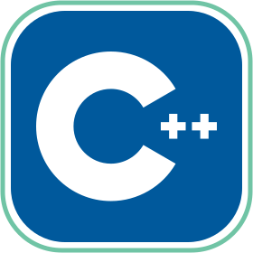
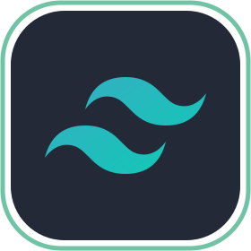
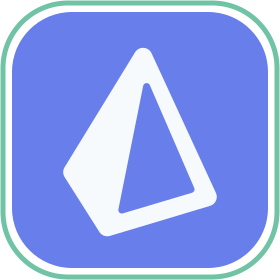
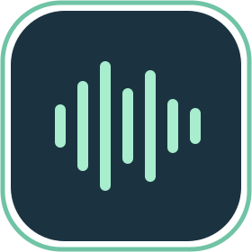
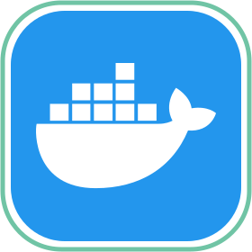
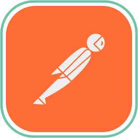

#  Gaddanti Sai Saran

**SDE Intern** · Web & mobile · B.Tech CSE, SRM University–AP (2024–2028)

[Projects](#projects) · [Experience](#experience) · [Tech stack](#tech-stack) · [Hackathons](#hackathons) · [Connect](#connect)

##  Projects

| Build | What it does | Links |
| --- | --- | --- |
| **Campus Hub** | Turns campus posters into events students can save. | [Calendar](https://campus-hub-gamma-eight.vercel.app/) · [Code](https://github.com/saisaran2116/Campus-hub) |
| **Sanjeevan** | Pairs report summaries with a voice-enabled health assistant. | [Demo](https://sanjeevan-omega.vercel.app/) · [Code](https://github.com/AnuragTummapudi/Sanjeevani) |
| **KalCG** | Tracks CGPA for 300+ Kalvium community members. | [Tracker](https://kalcg.netlify.app/) |

Build notes

- **Campus Hub** checks for scheduling conflicts even when an event runs past midnight. [Read the scheduling design](https://github.com/saisaran2116/Campus-hub/blob/main/LLD.md)
- **Sanjeevan** was a 24-hour build with Anurag Tummapudi. I built responsive components and connected them to the health-analysis backend.
- **KalCG** had a query form that returned HTTP 504s. I routed submissions directly to the Express API, added a ten-second timeout, and tested failure cases in Postman.

##  Experience

I build mobile and web interfaces and connect them to backend APIs.

Community roles

GirlScript Summer of Code contributor · Next Tech Lab associate

##  Tech stack

<table>
<tr>
<td width="50%" valign="top"><strong>Languages</strong> 
    
</td>
<td width="50%" valign="top"><strong>Web and mobile</strong> 
    
</td>
</tr>
<tr>
<td width="50%" valign="top"><strong>Backend APIs</strong> 
   
</td>
<td width="50%" valign="top"><strong>Databases</strong> 
    
</td>
</tr>
<tr>
<td width="50%" valign="top"><strong>AI and speech</strong> 
  
</td>
<td width="50%" valign="top"><strong>Tools and hosting</strong> 
      
</td>
</tr>
</table>

##  Hackathons

**Runner-up** · Omnitrix and CodeFusion　 **Top 10** · Web3SSH

Event results

| Event | Our build | Result |
| --- | --- | --- |
| Omnitrix | Sanjeevan, a voice-enabled healthcare prototype | Runner-up |
| CodeFusion · RD Conclave 2026 | Real-time patient care | Runner-up |
| Web3SSH | Rescu3, an Ethereum hardware wallet recovery project | Top 10 teams |
| ETHGlobal Mumbai | An Ethereum-based project | Participant |

##  Connect

Start an email about a project or opportunity

[Discuss a project](mailto:gaddantisaisaran@gmail.com?subject=Project%20collaboration) · [Discuss an internship](mailto:gaddantisaisaran@gmail.com?subject=Internship%20opportunity)

