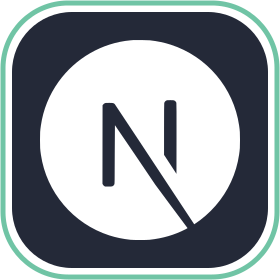
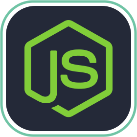
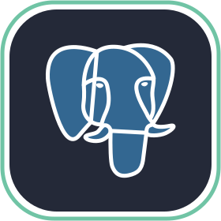
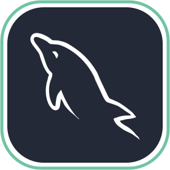
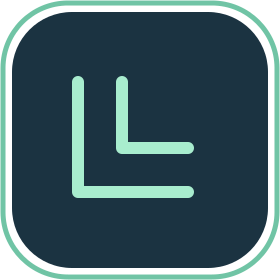
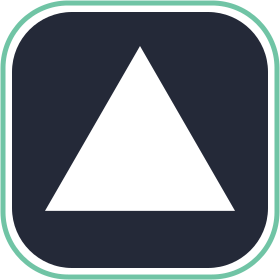
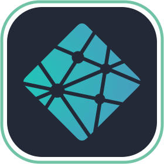
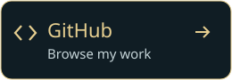

  
   
  

# Gaddanti Sai Saran

**SDE Intern · Full-stack and mobile development**

I study Computer Science and Engineering at SRM University–AP (B.Tech, 2024–2028). I build tools for students, from a campus event calendar to a grade tracker used by 300+ members of the Kalvium community.

[Projects](#projects) · [Experience](#experience) · [Tech stack](#tech-stack) · [Hackathons](#hackathons) · [Connect](#connect)

##  Projects

| Project | What you can do | Explore |
| --- | --- | --- |
| **Campus Hub** | Turn a poster into a campus event, submit it for approval, and save events to attend. | [Open calendar](https://campus-hub-gamma-eight.vercel.app/) · [Source](https://github.com/saisaran2116/Campus-hub) |
| **Sanjeevan** | Talk to a health assistant, track vitals, and read a plain-language summary of a report. | [Try prototype](https://sanjeevan-omega.vercel.app/) · [Source](https://github.com/AnuragTummapudi/Sanjeevani) |
| **KalCG** | Calculate your CGPA as a Kalvium student. | [Open tracker](https://kalcg.netlify.app/) |
| **Hey Baby** | Open desktop apps with a spoken command. Built-in commands work offline after setup. | [Setup and source](https://github.com/saisaran2116/heysaran) |

Behind the builds

- **Campus Hub** checks for scheduling conflicts even when an event runs past midnight. [Read the scheduling design](https://github.com/saisaran2116/Campus-hub/blob/main/LLD.md)
- **Sanjeevan** was a 24-hour build with Anurag Tummapudi. I built responsive components and connected them to the health-analysis backend.
- **KalCG** had a query form that returned HTTP 504s. I routed submissions directly to the Express API, added a ten-second timeout, and tested failure cases in Postman.

##  Experience

As an **SDE Intern**, I build responsive web and mobile interfaces, connect them to backend services, and debug the request from the screen through to the API.

Open-source and campus involvement

I contribute to open source through GirlScript Summer of Code and am an associate at Next Tech Lab, SRM University–AP.

##  Tech stack

Select a technology icon for its documentation.

**Languages**

    

**Web and mobile**

    

**Backend and storage**

        

**AI and speech tools**

  

**Tools and hosting**

      

##  Hackathons

My teams earned runner-up at **Omnitrix** and **CodeFusion** and finished in the **top 10 at Web3SSH**.

See the project behind each result

| Event | Our build | Result |
| --- | --- | --- |
| Omnitrix | Sanjeevan, a voice-enabled healthcare prototype | Runner-up |
| CodeFusion · RD Conclave 2026 | Real-time patient care | Runner-up |
| Web3SSH | Rescu3, an Ethereum hardware wallet recovery project | Top 10 teams |
| ETHGlobal Mumbai | An Ethereum-based project | Participant |

##  Connect

Have a project in mind? Email me about it, connect on LinkedIn, or explore the code on GitHub.

Start an email about a project or opportunity

[Discuss a project](mailto:gaddantisaisaran@gmail.com?subject=Project%20collaboration) · [Discuss an internship](mailto:gaddantisaisaran@gmail.com?subject=Internship%20opportunity)

