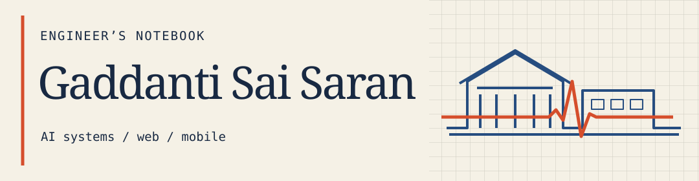

# Hi, I’m Sai Saran.

I study **Computer Science Engineering at SRM University–AP**. I build web and mobile apps and experiment with voice agents. Two of my favorite projects started with everyday questions. Could an organizer turn a campus poster into a calendar entry? Could a patient ask a question about a lab report out loud?

[Featured projects](#featured-projects) · [More builds](#more-builds) · [Toolkit](#toolkit) · [Hackathons](#hackathons) · [Contact](#contact)

## Featured projects

### Campus Hub

An organizer uploads a poster, checks the extracted event details, and submits it for staff approval. Students can then browse the event and save it. One scheduling detail I like is that an event running past midnight still gets checked against the next day’s bookings.

[Explore Campus Hub](https://campus-hub-gamma-eight.vercel.app/) · [Source code](https://github.com/saisaran2116/Campus-hub) · [Scheduling and database design](https://github.com/saisaran2116/Campus-hub/blob/main/LLD.md)

### Sanjeevan

Anurag Tummapudi and I built this healthcare prototype in 24 hours at **Omnitrix**, where our team took second place. Patients can upload a report for a plain-language summary, review their vitals, and ask follow-up questions by voice. I built responsive web components and connected them to the backend services.

[Explore Sanjeevan](https://sanjeevan-omega.vercel.app/) · [Team repository](https://github.com/AnuragTummapudi/Sanjeevani)

## More builds

| Project | What you can do with it |
| --- | --- |
| [Viśuddha](https://github.com/saisaran2116/visuddha-mobile) | Record an herb collection in the field with a photo and location, even when connectivity is patchy. |
| [Hey Baby](https://github.com/saisaran2116/heysaran) | Say “Hey Baby, open calculator” to a desktop assistant that recognizes commands offline after setup. |
| [Trip Sculptor](https://github.com/saisaran2116/Trip-sculptor) | Plan an itinerary and share it with the people traveling with you. |

[Browse my repositories](https://github.com/saisaran2116?tab=repositories)

## Toolkit

| Where I work | Tools I use |
| --- | --- |
| Languages | TypeScript, JavaScript, Python, Java, C++ |
| Web and mobile | React, Next.js, Tailwind CSS, React Native, Expo |
| APIs and data | Node.js, Express, PostgreSQL, MongoDB, MySQL, Redis, Firebase |
| AI and voice | Gemini, LiveKit, retrieval-augmented generation, prompt engineering |
| Design and delivery | Figma, Git, Postman, Docker, Vercel, Netlify, Render |

## Hackathons

I’ve participated in **10+ hackathons**, reached **6 finals**, and earned **2 runner-up finishes** with my teammates.

- **Omnitrix Hackathon** — Sanjeevan brought report summaries, vitals, and voice interaction into one patient dashboard.
- **CodeFusion at RD Conclave 2026** — With Vaaradhi AI, our team explored how a voice agent could help people interact with live health data. [Team repository](https://github.com/AnuragTummapudi/Vaaradhi-AI)

## Contact

If you’re building a campus tool or experimenting with a voice interface, I’d love to hear what you’re working on.

[Email me](mailto:gaddantisaisaran@gmail.com) · [Connect on LinkedIn](https://www.linkedin.com/in/sai-saran-gaddanti/)
